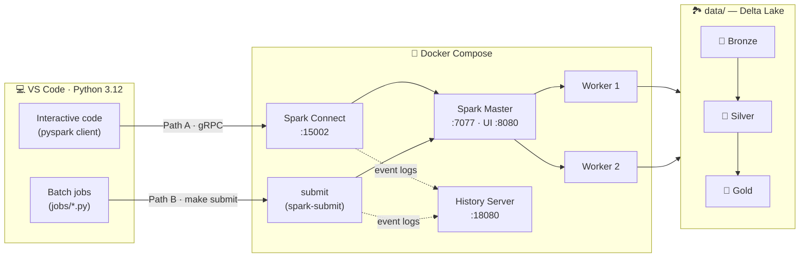

<p align="center">
  
</p>

<h1 align="center">HomeLake</h1>

<p align="center">
  <strong>A Databricks-style lakehouse that runs on your laptop.</strong><br>
  Spark&nbsp;cluster in Docker · Delta&nbsp;Lake medallion tables · built to <em>understand</em> Spark, not just use it.
</p>

<p align="center">
  
  
  
  
  
  
</p>

---

## Why HomeLake?

Managed platforms hide the interesting parts. HomeLake rebuilds a small lakehouse from the ground up — a Spark standalone cluster, Delta tables, a metastore, and later orchestration and a web workspace — so that every layer can be opened, measured and explained.

The goal is not just to make pipelines run, but to:

- 🔍 **Understand** how Spark executes work: drivers, executors, jobs, stages, tasks, shuffles and memory.
- 📏 **Measure** every optimization with reproducible before/after experiments.
- 🏅 **Practice** the medallion architecture (Bronze → Silver → Gold) on a realistic, deliberately messy e-commerce dataset.
- 💻 **Develop like on Databricks**: write and debug Python in VS Code, run it on a real (if tiny) cluster.

## Architecture



There are **two ways to run code** on the cluster:

| Path | How | Best for |
|---|---|---|
| **A — Spark Connect** | `SparkSession.builder.remote("sc://localhost:15002")` from your laptop | Interactive exploration and debugging in VS Code |
| **B — spark-submit** | `make submit JOB=jobs/my_job.py` | Batch jobs, RDD / `SparkContext` work, clean benchmark runs |

All Spark services share a single image (`dtp-spark`) so Spark, Python and JAR versions always match. Delta Lake and the PostgreSQL JDBC driver are baked in at build time — nothing is downloaded when containers start.

## Quick start

**Prerequisites:** Docker (Docker Desktop with WSL2 integration on Windows), `make`, Git, and Python 3.12 for the client side. Keep the repo on the Linux filesystem when using WSL2.

```bash
git clone git@github.com:Jay-boo/HomeLake.git
cd HomeLake

cp .env.example .env     # versions and cluster sizing
make build               # build the Spark image (~1 min)
make up                  # start master, 2 workers, Spark Connect, History Server
make ps                  # check that everything is running
```

Run the sample batch job:

```bash
make submit                              # runs jobs/hello_world.py
make submit JOB=jobs/my_job.py           # run your own job
```

Or connect interactively from Python:

```bash
pip install "pyspark[connect]==4.0.1"    # client version must match the server
```

```python
from pyspark.sql import SparkSession

spark = SparkSession.builder.remote("sc://localhost:15002").getOrCreate()
spark.range(10_000_000).selectExpr("sum(id) AS total").show()
```

> [!IMPORTANT]
> Pin the client to the server's Spark version. A newer client (e.g. 4.1) fails against a 4.0.1 server with errors like `SQL_CONF_NOT_FOUND`.

## Make commands

Run `make` on its own to list everything.

| Command | What it does |
|---|---|
| `make build` | Build the Spark image |
| `make up` / `make down` | Start / stop the cluster (`data/` is kept) |
| `make ps` | Show container status |
| `make logs SERVICE=spark-history TAIL=50` | Recent logs of a service (default: `spark-connect`, 100 lines) |
| `make follow SERVICE=spark-master` | Stream logs live |
| `make submit JOB=jobs/my_job.py` | Run a batch job on the cluster |
| `make restart SERVICE=spark-connect` | Recreate one service |
| `make shell SERVICE=spark-master` | Open a bash shell in a container |
| `make ui` | Print the web UI URLs |

## Web UIs

| UI | URL |
|---|---|
| Spark Master | http://localhost:8080 |
| Worker 1 / Worker 2 | http://localhost:8081 · http://localhost:8082 |
| Spark Connect application | http://localhost:4040 |
| History Server | http://localhost:18080 |

## Cluster sizing

The default cluster is sized to fit a laptop with ~8 GB available to Docker:

| | Cores | Memory |
|---|---|---|
| Each worker (×2) | 2 | 768 MB |
| Spark Connect (capped to one executor) | 1 | 512 MB |
| A `make submit` job (default) | 1 | 512 MB |

Spark Connect is capped with `spark.cores.max=1` so that a submitted job always finds a free worker. Tune `WORKER_CORES` and `WORKER_MEMORY` in `.env` if you have more resources.

## The lakehouse

HomeLake generates five e-commerce source datasets — intentionally including duplicates, malformed values, late-arriving events, skew and hot keys:

| Dataset | Raw format |
|---|---|
| customers | CSV with header |
| products | CSV with header |
| orders | Nested JSON Lines |
| payments | Parquet |
| events | JSON Lines |

They flow through managed Delta tables:

- 🥉 **Bronze** — source records as received, plus `_ingested_at`, `_source_file` and `_batch_id`.
- 🥈 **Silver** — cleaned, deduplicated, incrementally merged; rejected rows kept in `silver.rejects`.
- 🥇 **Gold** — revenue, customer lifetime value, product sales, payment reconciliation and funnel metrics.
- ⚙️ **Ops** — data-quality results and benchmark-run metadata.

## Project layout

```text
HomeLake/
├── infra/
│   ├── docker-compose.yml     # Spark master, workers, Connect, History, submit
│   └── spark/
│       ├── Dockerfile         # dtp-spark image (Spark + Delta + JDBC)
│       ├── entrypoint.sh
│       └── conf/spark-defaults.conf
├── jobs/                      # batch jobs run with `make submit`
├── tests/
├── docs/                      # architecture, roadmap, decisions, internals
├── data/                      # local lakehouse data (git-ignored)
├── .env.example
└── Makefile
```

Further folders (ingestion, transformations, DAGs, workspace UI…) are added as each roadmap phase begins.

## Roadmap

- [ ] **1. Infrastructure & VS Code connection** — Spark cluster, Spark Connect, submit path, History Server *(in progress)*
- [ ] **2. Lakehouse foundation** — data generator, Bronze/Silver/Gold, PostgreSQL-backed metastore
- [ ] **3. Distributed processing**
- [ ] **4. Spark optimization lab**
- [ ] **5. Spark internals & cluster tuning**
- [ ] **6. Orchestration with Airflow**
- [ ] **7. Workspace UI** — catalog, SQL editor, jobs and compute (FastAPI + React)
- [ ] **8. Final challenge & case study**

Details and acceptance criteria: [`docs/roadmap.md`](docs/roadmap.md).

## Principles

- **Everything is code** — images, config, tables, DAGs and UI live in Git.
- **Reproducible** — pinned versions, seeded data, recorded benchmark configuration.
- **Idempotent** — every job is safe to rerun.
- **Explicit schemas** — no `inferSchema`.
- **Pure transformations** — DataFrame-in, DataFrame-out; jobs handle I/O.
- **Evidence over opinion** — plans, screenshots and benchmark results back every claim.

## Limitations

HomeLake is a single-machine learning environment, not a production cluster: workers share the host CPU and disk, and there is no real network or machine-failure isolation. Cloud storage, Unity Catalog, Photon, ML and streaming are out of scope for the first version.

Spark Connect does not expose the RDD API or `SparkContext` — use `make submit` for that. Because the Connect server is one long-running application, interactive runs all appear under it in the UIs; use submitted jobs for clean benchmark attribution.

## Documentation

- [Architecture](docs/architecture.md) — components, execution paths, data layout
- [Roadmap](docs/roadmap.md) — phases, checks and deliverables
- [Decisions](docs/decisions.md) — architecture decision log
- [Baseline](docs/baseline.md) — machine and first-run baseline
- [Spark internals](docs/internals/README.md) — notes on how Spark works
- [Case study](docs/case-study.md) — final write-up template
